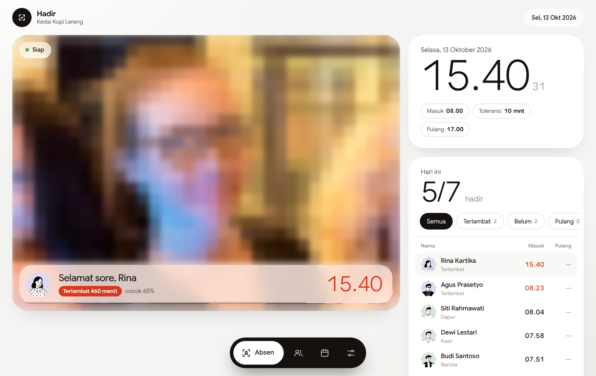
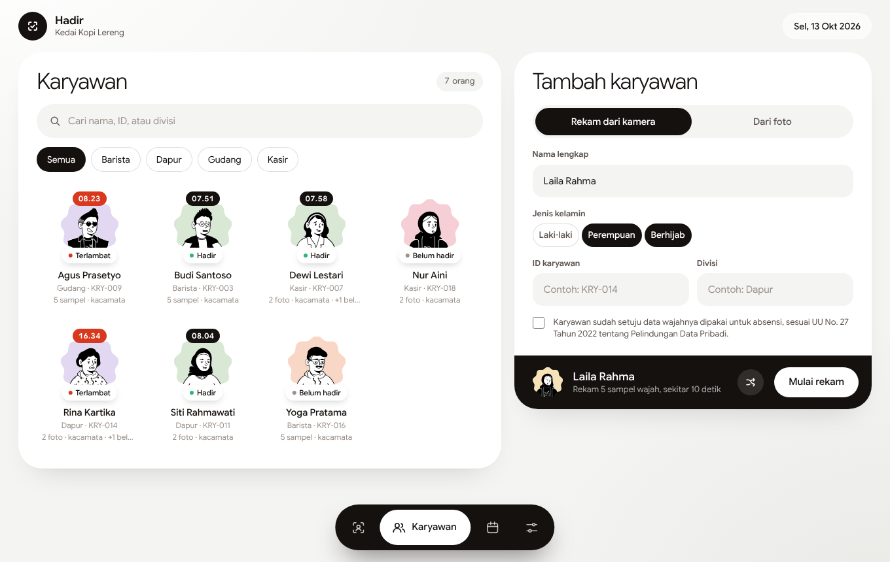
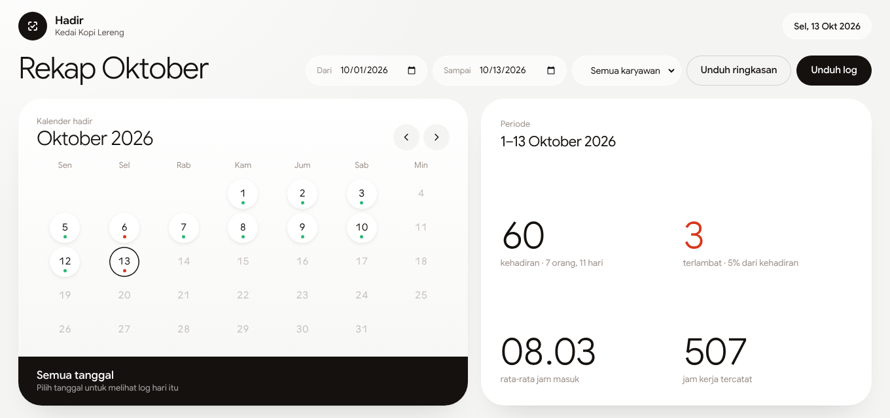

# Hadir

**Absensi wajah untuk usaha kecil. Cukup tablet atau laptop berkamera.**

[**Coba sekarang →**](https://ghozi-abdullah.github.io/Absensi-Face-ID/)

Hadir mengubah perangkat yang sudah kamu punya menjadi mesin absensi. Karyawan cukup menatap kamera sekitar setengah detik, lalu jam masuk, status terlambat, dan jam pulang tercatat sendiri. Di akhir bulan, rekapnya sudah siap untuk penggajian.

Dibuat untuk kedai, bengkel, klinik, toko, dan kantor kecil yang selama ini mencatat absensi di buku atau grup WhatsApp, dan tidak ingin membeli mesin fingerprint jutaan rupiah.

## Kenapa Hadir

**Tidak bisa titip absen.** Wajah dicocokkan dengan semua karyawan terdaftar, dan absen hanya tercatat bila wajah jelas lebih mirip ke satu orang dibanding yang lain. Wajah yang ragu-ragu atau tidak dikenal ditolak.

**Tetap kenal walau pakai kacamata.** Setiap wajah yang didaftarkan otomatis disiapkan juga dalam beberapa versi berkacamata, jadi karyawan yang didaftarkan dari foto tanpa kacamata tetap dikenali saat datang berkacamata.

**Data wajah tidak keluar dari perangkat.** Pengenalan wajah berjalan langsung di browser. Tidak ada foto yang disimpan, dan tidak ada data wajah yang dikirim ke server mana pun.

**Tetap jalan saat internet mati.** Hadir bisa dipasang di layar utama tablet seperti aplikasi biasa dan terus mencatat absen tanpa koneksi.

**Gratis dan tanpa server.** Cukup buka di browser. Tidak ada biaya langganan, tidak ada akun yang perlu dibuat.

## Fitur

### Absen dalam hitungan detik
Karyawan disapa dengan namanya ("Selamat pagi, Rina") bersama jam yang tercatat. Kartu hasil berwarna hijau untuk tepat waktu dan merah untuk terlambat, seperti cap jam di mesin absen. Di samping kamera ada daftar hadir hari ini: siapa yang sudah masuk, siapa yang terlambat, dan siapa yang belum datang.

### Daftar karyawan lewat kamera atau foto
Rekam 5 sampel wajah langsung di depan kamera, atau unggah 1–5 foto seperti pas foto dan foto KTP. Foto yang buram, tanpa wajah, atau berisi beberapa orang langsung ditandai. Hadir juga belajar dari absen sehari-hari: wajah yang jelas cocok tapi tampak berbeda, misalnya karena kacamata atau potongan rambut baru, ikut disimpan supaya makin mudah dikenali.

### Rekap siap untuk penggajian
Lembar hadir menampilkan semua karyawan dalam satu tabel dengan tanda H (hadir), T (terlambat), dan A (tidak hadir) per tanggal, lengkap dengan hari libur. Lihat juga jumlah kehadiran, keterlambatan, pulang lebih awal, rata-rata jam masuk, dan total jam kerja per karyawan, untuk rentang tanggal mana pun. Rekap bisa diunduh sebagai CSV yang siap dibuka di Excel atau Google Sheets.

### Tersambung ke Google Sheets
Setiap absen bisa otomatis masuk ke Google Sheet sebagai satu baris baru, jadi pemilik usaha bisa memantau dari HP di mana saja. Absen yang tercatat saat offline dikirim begitu koneksi kembali.

### Ilustrasi untuk setiap karyawan
Setiap karyawan mendapat ilustrasi garis yang unik sebagai foto profil, sesuai jenis kelaminnya, termasuk pilihan berhijab. Daftar hadir tetap terasa personal tanpa menyimpan foto wajah siapa pun. Ilustrasi bisa diacak ulang, dan profil karyawan bisa diubah kapan saja.

### Aman ditinggal di meja depan
Kunci menu admin dengan PIN supaya karyawan hanya bisa mengakses layar absen. Atur jam masuk, toleransi keterlambatan, dan jam pulang sesuai aturan tempat kerjamu.

<table>
  <tr>
    <td></td>
    <td></td>
  </tr>
  <tr>
    <td align="center">Daftar karyawan</td>
    <td align="center">Rekap kehadiran</td>
  </tr>
</table>

## Privasi

Hadir dirancang mengikuti UU No. 27 Tahun 2022 tentang Pelindungan Data Pribadi. Setiap pendaftaran wajah meminta persetujuan karyawan. Foto hanya dibaca untuk diubah menjadi kode wajah, lalu dibuang. Yang dikirim ke Google Sheets hanya nama, ID, divisi, waktu, dan status. Data karyawan yang keluar bisa dihapus kapan saja.

## Dibangun dengan

TensorFlow.js · face-api · JavaScript · IndexedDB · Progressive Web App · Google Sans Flex · GitHub Pages

---

Dibuat oleh [Ghozi Abdullah](https://github.com/Ghozi-Abdullah) · Proyek Hari 1 dari **#30Hari30Website**

Lisensi MIT · Pengenalan wajah oleh [face-api](https://github.com/vladmandic/face-api) dan [TensorFlow.js](https://github.com/tensorflow/tfjs) · Huruf Google Sans Flex (SIL Open Font License) · Ilustrasi [Notionists](https://www.dicebear.com/styles/notionists/) oleh Zoish (CC0) lewat DiceBear

